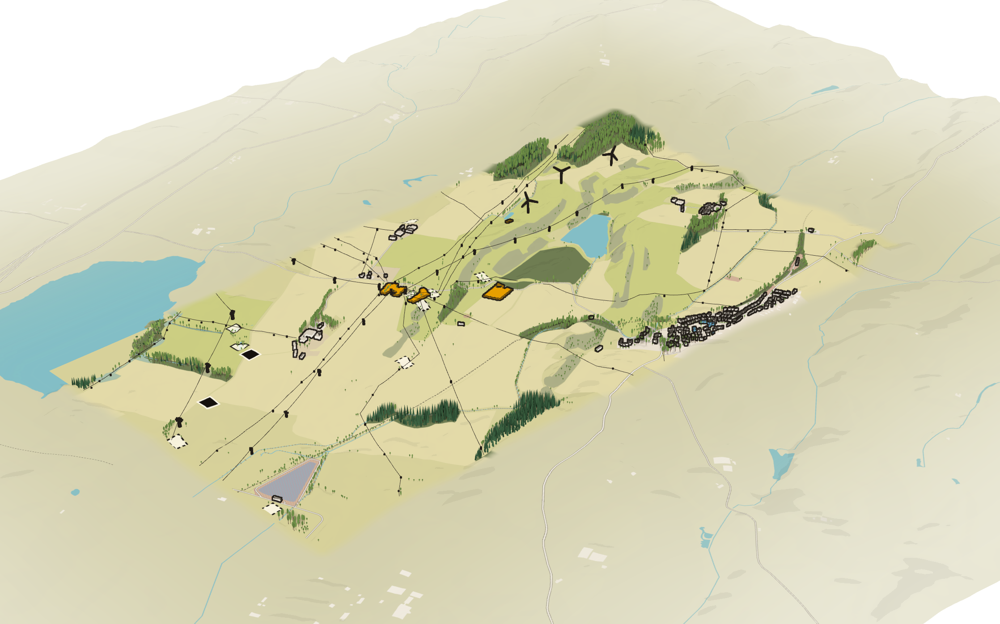

# Hyperscale Landscapes

**See, hold and share the landscape that a proposed data centre would be fused to.**

Planning documents reduce proposed data-centre sites to red lines and grid
references. This toolkit turns a site into evidence people can hold and share:

- **3D-printable models.** These are multi-colour terrain models showing rivers,
  power lines and substations, old mines and bings (spoil heaps), homes and
  schools. In Scotland the terrain comes from Scottish Government LiDAR. The
  models show the land as it is: they do not model the proposed buildings,
  whose size and shape are rarely published precisely enough.
- **Digital artefacts.** These are rotating GIFs, landscape images, cross-sections and
  interactive 3D viewers, sized for Facebook, WhatsApp, slides and
  leaflets.

Every model and image states its data sources and its vertical
exaggeration, because these are used as evidence.

> **Status: early development (Phase 4 of 7).** The browser app and the Python
> command-line tool both build multi-colour print files, captioned images and
> offline 3D viewers, for 27 curated sites or any area you draw. The scale card, info pack and
> beginners' guides are still to come. See [PLAN.md](PLAN.md).

## For organisers

You don't need to install anything. Open the web app, pick a curated site or
draw an area, and preview it in 3D. From there you can:

- save **images** for Facebook, WhatsApp, slides or leaflets, with a caption
  showing the sources and the height exaggeration built into the picture;
- make a **rotating GIF or video** of the model (square, portrait or wide;
  GIFs kept under 8 MB; MP4 where your browser supports it, for WhatsApp);
- draw a **cross-section** line, for example from a village through the site
  to a substation, and save the profile as an image, at true scale unless you
  choose otherwise;
- download an **interactive 3D viewer**, a single file that opens in any
  browser, works offline, and can be emailed;
- download a **print file** for a 3D printer.

The **Context views** at the top of the layers panel show one view at a time,
on screen only and never in the print. **Terrain** (the default) is the land
about 1.6 km beyond the model, with the main roads, railways, water, buildings
and place names, running on from the model's edge with a light fade.
**Electricity Grid** is the electricity network: pylons, poles and overhead
lines, with the model's edge fading into the background in the same way. With
either, the camera stays above the ground and the soil sides and geology walls
are off. **Geological** shows the model as a block of ground, with its soil
sides and geology walls. Labels are a separate layer, off by default.



The preview offers a land-cover map or open satellite imagery (Sentinel-2,
10 m) as the surface. It all runs in
your browser. The browser's print files are lower resolution than the
command-line tool's. For exhibitions or planning hearings, ask a maker or
researcher to run the command-line tool.

To run the web app locally: `python3 tools/serve.py`, then open
<http://localhost:8765>. It tells the browser not to reuse stored copies of the
code, so edits show on the next reload.

## For technical users

```bash
pip install -e "pipeline[uk]"          # from a checkout; Python 3.10+
hyperscale sites list
hyperscale build --site auchtertool-cato
hyperscale build --min_lat 56.0916 --max_lat 56.1064 --min_lon -3.3054 --max_lon -3.2457 --stl
```

### Presets and layers

```bash
hyperscale build --site auchtertool-cato --preset residues
```

Elevation in Scotland comes from the Scottish Public Sector LiDAR terrain
model (bare earth, read at 2 m from the public `srsp-open-data` bucket; newer
surveys take priority). Any gaps are filled from Copernicus 30 m, and the
manifest records how much. `--elevation copernicus` or `--elevation srtm`
uses the coarser global sources instead.

| Preset | Filament slots |
|---|---|
| `power-and-place` (default) | Land · Water · Power, roads and rail · Buildings |
| `residues` | Land · Water · Industrial residues · Buildings, roads and rail |
| `full` | up to eight objects |
| `classic` | Land · Water · Roads · Buildings (the original layout) |
| `single-colour` | one watertight STL |

The underside of the base is engraved with the site name, the height exaggeration,
the data sources, the date, a north arrow and a scale bar. Turn the model over to
read them.

Outputs go to `./output/`:

- `terrain_*.3mf`: one object each for Land, Water, Roads and Buildings, pre-assigned to filament slots 1–4
- `terrain_*.stl`: with `--stl`, a single watertight body for one-colour printing
- `features_*.geojson`: power, rail, residues, receptors and land cover, for the viewer
- `viewer_*.html`: with `--viewer`, the offline interactive 3D viewer at full resolution
- `manifest_*.json`: statistics, printability check, pause heights for single-extruder colour changes, and full data provenance

Downloads are cached in your user cache folder (`~/.cache/hyperscale-landscapes`
on Linux, `~/Library/Caches/hyperscale-landscapes` on macOS).

Defaults: 150 mm print, terrain height ×2, buildings at true height, 5 mm
base. The models are designed to print **without supports**.

## Data and licences

Map data © OpenStreetMap contributors (ODbL). Elevation, coastline and other
sources are listed with their licences in [DATA_LICENCES.md](DATA_LICENCES.md).
Curated site data is CC BY 4.0. The source code is GPL-3.0-or-later
([LICENSE](LICENSE)). All exports and downloads are
[CC BY-NC-SA 4.0](LICENCE-CC-BY-NC-SA-4.0.txt): this is a non-commercial
research and educational project (University of Glasgow). See the terms of use at the top of
[DATA_LICENCES.md](DATA_LICENCES.md).

## Credits

Jamie Cross (University of Glasgow) and Alex Nading (Cornell University).
See [CITATION.cff](CITATION.cff).
